# clawd-buddy-gauges

[Tiếng Việt](README.vi.md)

A little crab that keeps you company while Claude Code works, and tells you at a glance what is going on.

**clawd-buddy-gauges** puts one band above the prompt. Clawd acts out every step: thinks with a wizard hat, types
in the Matrix, jogs while a command runs, flexes when the turn is done. Beside it sit the gauges you otherwise go
looking for: how full the context is, how much of your 5-hour and weekly limits is left, and how long the prompt
cache still holds. When the cache runs out, the band says so in red, and Compact is one click away.

**Thinking**<br>


**Editing a file**<br>


**Turn done**<br>


**Resting, the prompt cache counting down**<br>


**Cache run out: time to Compact**<br>


<sub>Drawn from the mod's own code with sample numbers.</sub>

<p>
  
  
  
  
</p>

**[▶ See every Clawd animation, mood by mood](docs/PETS.md)**

## What's in the band

- **Left, the buddy.** Clawd acts out what Claude is doing: thinking, reading, editing, running commands, waiting
  for you, done, failing tests, compacting. Seventeen moods, three to six animations each.
  [See them all](docs/PETS.md). In the desktop app, click Clawd to step through the animations of the mood it is in.
- **Middle, the gauges.** `CTX` (context used, with a tick where auto-compact kicks in), `5H` and `7D` (your
  5-hour and weekly usage limits, with the 5-hour pace projected to its reset), and the turn clock. Under them, a
  line on what Claude is doing.
- **Right, Compact.** Runs the same compaction as `/compact`. In the desktop app it also counts down the prompt
  cache and turns red when the cache has run out.
- **⎇** opens the session folder's git repos and their branches, to switch branch from the band.

Shows in the Claude Code desktop app and in the VS Code extension. The terminal is left as it is.

## Install

**The easy way:** open Claude Code (desktop app or VS Code), paste this in and send it:

```text
Install the Claude Code plugin clawd-buddy-gauges for me. Run these two commands in the terminal:
claude plugin marketplace add Vietanh2996/clawd-buddy-gauges
claude plugin install clawd-buddy-gauges@clawd-buddy-gauges
Then run "claude plugin list" to check it is installed and enabled, and tell me in plain words whether it worked. If it did, remind me to start a new session to see the band.
```

**Or by hand,** in a terminal:

```bash
claude plugin marketplace add Vietanh2996/clawd-buddy-gauges
```

```bash
claude plugin install clawd-buddy-gauges@clawd-buddy-gauges
```

Start a new session to see the band. Later updates:

```bash
claude plugin marketplace update clawd-buddy-gauges
```

## Use

- `/clawd` shows or hides the band; `/clawd on` and `/clawd off` say which.

## Work on it

Clone the repo, edit, then run `./reinstall.sh` to install your checkout as the copy Claude Code runs (it bumps the
patch version each time; `--minor` for a bigger round). Tests sit in `plugins/clawd-buddy-gauges/tests`.

## Credits and license

Built on three open projects, with thanks:

- [clawd-crew](https://github.com/hudcolighting/clawd-crew) by hudcolighting (GPL-3.0-or-later): the Clawd pixel
  art and its animations. Eighteen more animations were drawn here in the same style.
- [clawd-pet](https://github.com/Revono/clawd-pet) by Revono (MIT): where the band started, and its icon.
- [clawd-companion](https://github.com/DevVaradPatil/clawd-companion) by Varad Patil (MIT): the gauges, from its
  clawd-bar mod.

Licensed under the GNU General Public License v3.0 or later, see [LICENSE](LICENSE). What came from where, and the
original MIT notices: [NOTICE.md](NOTICE.md).

Unofficial fan project. Claude, Claude Code and Clawd are Anthropic's; this mod is not made, endorsed or supported
by Anthropic.
