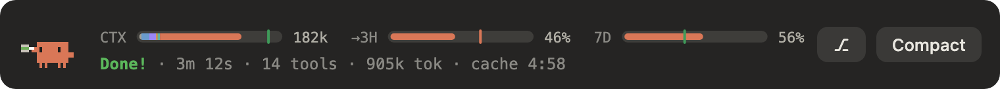
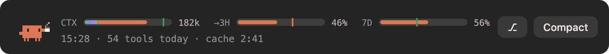
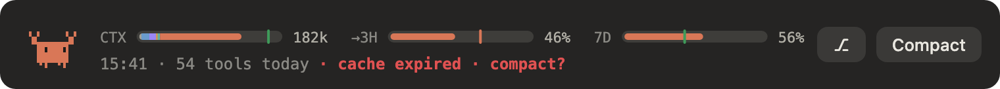
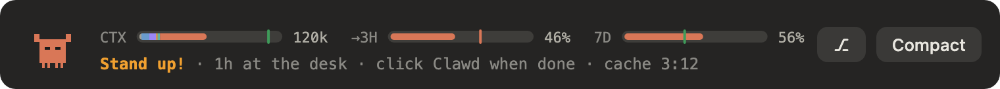
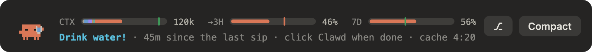

# clawd-buddy-gauges

[English](README.md)

Một bạn cua nhỏ ngồi cạnh khi Claude Code làm việc, liếc qua là biết nó đang làm gì.

**clawd-buddy-gauges** đặt một dải ngay trên ô nhập. Clawd diễn lại từng bước: đội mũ phù thủy lúc nghĩ, gõ phím kiểu
Matrix lúc sửa file, chạy bộ lúc chạy lệnh, khoe cơ khi xong lượt. Bên cạnh là các con số bình thường phải đi tìm:
context đã đầy bao nhiêu, hạn mức 5 giờ và theo tuần còn bao nhiêu, cache prompt còn giữ được bao lâu. Hết cache thì
dải báo chữ đỏ, bấm Compact là xong.

**Đang nghĩ**<br>


**Đang sửa file**<br>


**Xong lượt**<br>


**Nghỉ giữa các lượt, cache đang đếm ngược**<br>


**Hết cache: nên bấm Compact**<br>


**Ngồi đủ 1 tiếng: đứng dậy đi**<br>


**45 phút: uống ngụm nước**<br>


<sub>Vẽ từ chính code của mod, với số liệu mẫu.</sub>

<p>
  
  
  
  
</p>

**[▶ Xem hết các con Clawd, theo từng tình huống](docs/PETS.vi.md)**

## Trên dải có gì

- **Bên trái, bạn Clawd.** Clawd diễn lại việc Claude đang làm: nghĩ, đọc, sửa file, chạy lệnh, chờ bạn, xong lượt,
  test fail, đang compact. Có 17 trạng thái, mỗi trạng thái 3 tới 7 kiểu. [Xem hết các kiểu](docs/PETS.vi.md).
  Trên app desktop, bấm vào Clawd để đổi lần lượt các kiểu của trạng thái đang hiện.
- **Ở giữa, các thanh đo.** `CTX` (context đã dùng, có vạch chỗ tự compact), `5H` và `7D` (hạn mức 5 giờ và theo
  tuần, kèm dự báo tốc độ dùng của hạn 5 giờ tới lúc reset), và đồng hồ lượt. Bên dưới là dòng chữ Claude đang làm gì.
- **Bên phải, nút Compact.** Chạy y như `/compact`. Trên app desktop nút này còn đếm ngược cache prompt, hết cache
  thì chuyển đỏ.
- **⎇** mở danh sách repo git trong thư mục session và các nhánh của chúng, đổi nhánh ngay trên dải.
- **Stand up!** Ngồi đủ 1 tiếng thì dòng trạng thái chuyển chữ vàng nhắc đứng dậy, Clawd vươn vai. Đứng dậy xong
  bấm vào Clawd (VS Code thì gõ `/clawd remind`), tiếng tiếp theo tính từ lúc đó. Mọi session dùng chung một lời
  nhắc, tắt ở một session là tắt hết.
- **Drink water!** Cứ 45 phút, đếm riêng, dòng trạng thái chuyển chữ xanh nhạt nhắc uống nước, Clawd cầm cốc uống.
  Uống xong bấm vào Clawd. Hai lời nhắc trùng giờ thì nhắc đứng dậy trước.
- **Mũ và giờ trong ngày.** Tết Clawd đội khăn đóng, Noel đội mũ ông già Noel, năm mới đội mũ tiệc, Halloween đội
  bí ngô, khuya đội mũ ngủ, hay ngáp và ngủ sớm hơn. Sáng sớm thì cà phê và vươn vai. [Xem các mũ](docs/PETS.vi.md#mũ).

Hiện trên app desktop Claude Code và extension VS Code. Terminal giữ nguyên, không đổi.

## Cài đặt

**Cách dễ nhất:** mở Claude Code (app desktop hoặc VS Code), dán đoạn này vào rồi gửi:

```text
Cài giúp tôi plugin Claude Code tên clawd-buddy-gauges. Chạy hai lệnh này trong terminal:
claude plugin marketplace add Vietanh2996/clawd-buddy-gauges
claude plugin install clawd-buddy-gauges@clawd-buddy-gauges
Sau đó chạy "claude plugin list" để kiểm tra đã cài và đang bật chưa, rồi báo tôi bằng lời dễ hiểu là được hay chưa. Nếu được thì nhắc tôi mở session mới để thấy dải.
```

**Hoặc tự gõ** trong terminal:

```bash
claude plugin marketplace add Vietanh2996/clawd-buddy-gauges
```

```bash
claude plugin install clawd-buddy-gauges@clawd-buddy-gauges
```

Mở session mới là thấy dải. Lấy bản mới về sau này:

```bash
claude plugin marketplace update clawd-buddy-gauges
```

## Dùng

- `/clawd` bật hoặc tắt dải; `/clawd on`, `/clawd off` để chỉ rõ.
- `/clawd remind 45` nhắc đứng dậy mỗi 45 phút thay vì 60; `/clawd remind off` tắt nhắc; `/clawd remind` trơn là
  đã đứng dậy, đếm lại từ đầu.
- `/clawd water 30` nhắc uống nước mỗi 30 phút thay vì 45; `/clawd water off` tắt; `/clawd water` trơn là đã uống.
- `/clawd hat santa` đội cố định một mũ (`tet`, `santa`, `party`, `pumpkin`, `nightcap`); `/clawd hat none` bỏ mũ;
  `/clawd hat auto` quay về theo lịch.

## Sửa mod

Clone repo, sửa, rồi chạy `./reinstall.sh` để cài bản đang sửa thành bản Claude Code chạy (mỗi lần tự nâng số bản;
`--minor` cho đợt sửa lớn). Test nằm trong `plugins/clawd-buddy-gauges/tests`.

## Nguồn và giấy phép

Dựa trên ba dự án mở, xin cảm ơn:

- [clawd-crew](https://github.com/hudcolighting/clawd-crew) của hudcolighting (GPL-3.0-or-later): hình pixel Clawd
  và các animation. Vẽ thêm 20 animation và bộ mũ cùng phong cách.
- [clawd-pet](https://github.com/Revono/clawd-pet) của Revono (MIT): khung ban đầu của dải, và icon.
- [clawd-companion](https://github.com/DevVaradPatil/clawd-companion) của Varad Patil (MIT): các thanh đo, từ mod
  clawd-bar.

Phát hành theo GNU General Public License v3.0 hoặc mới hơn, xem [LICENSE](LICENSE). Phần nào lấy từ đâu và nguyên
văn thông báo MIT gốc: [NOTICE.md](NOTICE.md).

Dự án fan làm, không chính thức. Claude, Claude Code và Clawd thuộc về Anthropic; mod này không do Anthropic làm,
bảo trợ hay hỗ trợ.
