# Every look of Clawd

[Tiếng Việt](PETS.vi.md)

Each mood has three to six looks; the buddy picks one at random when the mood changes. Click it in the desktop app to step to the next look of the mood it is in, wrapping round after the last.

The first three looks of each mood are from [clawd-crew](https://github.com/hudcolighting/clawd-crew) (GPL-3.0-or-later). The ones after them were drawn for clawd-buddy-gauges from the same body, eyes, arms and legs.

| Mood · when it shows | Look 1 | Look 2 | Look 3 | Look 4 | Look 5 | Look 6 |
|---|:-:|:-:|:-:|:-:|:-:|:-:|
| **idle** Idle, waiting for you |  Classic |  Coffee |  Humming |  Yawn |  Crab |  |
| **sleeping** Idle for over 10 minutes |  Classic |  Tucked in |  Dozing |  |  |  |
| **thinking** Claude is thinking |  Classic |  Pacing |  Cube |  Wizard |  Ultrathink |  |
| **responding** Claude is writing its reply |  Classic |  Letter |  Board |  |  |  |
| **typing** Editing or writing files (Edit, Write) |  Classic |  Matrix |  Desk |  Nod off |  |  |
| **reading** Reading files (Read) |  Classic |  Paper |  Tablet |  |  |  |
| **searching** Searching files and text (Grep, Glob) |  Classic |  Torch |  Binocs |  |  |  |
| **running** Running commands (Bash) |  Classic |  Treadmill |  Progress |  Carry |  Jog |  Squat |
| **browsing** On the web (WebFetch, WebSearch, browser) |  Classic |  Surfing |  Browser |  |  |  |
| **delegating** Handing work to a subagent (Agent) |  Classic |  Hand-off |  Tower |  Juggle |  |  |
| **rallying** Running a workflow |  Classic |  Line |  Horde |  Conduct |  |  |
| **planning** Planning, task lists |  Classic |  Map |  Stickies |  |  |  |
| **tooling** Other tools, MCP |  Classic |  Hammer |  Toolbox |  Build |  |  |
| **waiting** Needs you: a permission, a question, a plan to approve |  Classic |  Sign |  Bell |  Wiggle |  |  |
| **done** Turn done; tests passed; clicked |  Classic |  Trophy |  Dance |  Wink |  Juiced |  |
| **error** A command failed; tests failed |  Classic |  Smoke |  Rain |  Debug |  Toot |  Raspberry |
| **compacting** Compacting |  Classic |  Squeeze |  Vacuum |  Sweep |  |  |

<!-- The pictures in pets/ are drawn from plugins/clawd-buddy-gauges/hooks/crew-sprites.js. -->
