# Every look of Clawd

[Tiếng Việt](PETS.vi.md)

Each mood has three to eight looks; the buddy picks one at random when the mood changes (in the morning it leans to coffee, late at night to yawns). Click it in the desktop app to step to the next look of the mood it is in, wrapping round after the last.

The first three looks of each mood are from [clawd-crew](https://github.com/hudcolighting/clawd-crew) (GPL-3.0-or-later), except Wizard (thinking) and Carry (running), our own, which moved up when Cube and Progress were archived. The rest were drawn for clawd-buddy-gauges from the same body, eyes, arms and legs.

| Mood · when it shows | Look 1 | Look 2 | Look 3 | Look 4 | Look 5 | Look 6 | Look 7 | Look 8 |
|---|:-:|:-:|:-:|:-:|:-:|:-:|:-:|:-:|
| **idle** Idle, waiting for you |  Classic |  Coffee |  Humming |  Yawn |  Peach · Tết only |  Keepie-ups |  Hoops |  Fishing |
| **sleeping** Idle for over 10 minutes (3 late at night) |  Classic |  Tucked in |  Dozing |  Snot bubble |  |  |  |  |
| **thinking** Claude is thinking |  Classic |  Pacing |  Wizard |  Toilet |  Power up |  |  |  |
| **responding** Claude is writing its reply |  Classic |  Letter |  Board |  |  |  |  |  |
| **typing** Editing or writing files (Edit, Write) |  Classic |  Matrix |  Desk |  Nod off |  |  |  |  |
| **reading** Reading files (Read) |  Classic |  Paper |  Tablet |  |  |  |  |  |
| **searching** Searching files and text (Grep, Glob) |  Classic |  Torch |  Binocs |  |  |  |  |  |
| **running** Running commands (Bash) |  Classic |  Treadmill |  Carry |  Jog |  Squat |  |  |  |
| **browsing** On the web (WebFetch, WebSearch, browser) |  Classic |  Surfing |  Browser |  |  |  |  |  |
| **delegating** Handing work to a subagent (Agent) |  Classic |  Hand-off |  Tower |  Juggle |  |  |  |  |
| **rallying** Running a workflow |  Classic |  Line |  Horde |  Conduct |  |  |  |  |
| **planning** Planning, task lists |  Classic |  Map |  Stickies |  |  |  |  |  |
| **tooling** Other tools, MCP |  Classic |  Hammer |  Toolbox |  Build |  |  |  |  |
| **waiting** Needs you: a permission, a question, a plan to approve |  Classic |  Sign |  Bell |  Wiggle |  |  |  |  |
| **done** Turn done; tests passed; clicked |  Classic |  Trophy |  Dance |  Wink |  Juiced |  Clap |  |  |
| **error** A command failed; tests failed |  Classic |  Smoke |  Rain |  Debug |  Toot |  Raspberry |  |  |
| **compacting** Compacting |  Classic |  Squeeze |  Vacuum |  Sweep |  Suitcase |  |  |  |

## Reminders

Two reminders, each on its own clock and shared by all your sessions. When one is due the status line says so in
its colour, and Clawd acts it out when it is not busy. Click Clawd once you have done it (in VS Code, type the
command): the next one counts from then, in every session. When both are due, standing up comes first.

| Stand up · every 60 min · `/clawd remind <min>\|off` | Drink water · every 45 min · `/clawd water <min>\|off` |
|:-:|:-:|
|  Stretch |  Water |

**Stand up!** 

**Drink water!** 

The stretch and water looks only show for their reminder: never at random, and a click on Clawd skips them.

## Out of usage

When a usage limit (5-hour or weekly) is used up and Claude is not busy, the status line turns red and says when the
limit resets. Clawd idles in his usual looks; none is drawn for this moment yet.

## Hats

On holidays Clawd wears a hat over every look, and a nightcap late at night. `/clawd hat <name>` keeps one on
(`tet`, `santa`, `party`, `pumpkin`, `nightcap`), `/clawd hat none` takes it off, `/clawd hat auto` goes back to the
calendar. Tết runs from three days before the first day of the lunar year to four days after.

| Áo dài · Tết | Santa · 20–26 Dec | Party · 31 Dec–1 Jan | Pumpkin · 25–31 Oct | Nightcap · 23:00–05:00 |
|:-:|:-:|:-:|:-:|:-:|
|  tet |  santa |  party |  pumpkin |  nightcap |

## Archived

These looks are put away: their drawing code and pictures stay, but the buddy never shows them, not even on a click. To bring one back, take its name out of `ARCHIVED` in `hooks/crew-pet.ts`.

| Crab · idle | Cube · thinking | Ultrathink · thinking | Progress · running | Lì xì |
|:-:|:-:|:-:|:-:|:-:|
|  Crab |  Cube |  Ultrathink |  Progress |  Lì xì |

<!-- The pictures in pets/ are drawn from plugins/clawd-buddy-gauges/hooks/crew-sprites.js. -->
