# Các dáng của Clawd

[English](PETS.md)

Mỗi trạng thái có từ 3 tới 12 kiểu, pet chọn ngẫu nhiên một kiểu khi đổi trạng thái (sáng sớm hay uống cà phê, khuya hay ngáp). Bấm vào pet trên app desktop để đổi lần lượt sang kiểu kế tiếp của trạng thái đang hiện, hết thì quay lại kiểu đầu.

Ba kiểu đầu của mỗi trạng thái lấy từ [clawd-crew](https://github.com/hudcolighting/clawd-crew) (GPL-3.0), trừ Wizard (thinking) và Carry (running): hai kiểu tự vẽ này được đẩy lên khi Cube và Progress bị cất. Các kiểu còn lại tự vẽ cho clawd-buddy-gauges, cùng bộ thân, mắt, tay, chân.

### **idle** — Rảnh, chờ bạn gõ

| Kiểu 1 | Kiểu 2 | Kiểu 3 | Kiểu 4 | Kiểu 5 | Kiểu 6 | Kiểu 7 | Kiểu 8 |
|:-:|:-:|:-:|:-:|:-:|:-:|:-:|:-:|
|  Classic |  Coffee |  Humming |  Yawn |  Peach · chỉ dịp Tết |  Keepie-ups |  Hoops |  Fishing |
|  Kickflip |  Real crab |  Claw machine |  Boxing |  |  |  |  |

### **sleeping** — Rảnh lâu hơn 10 phút (khuya thì 3 phút)

| Kiểu 1 | Kiểu 2 | Kiểu 3 | Kiểu 4 | Kiểu 5 | Kiểu 6 | Kiểu 7 | Kiểu 8 |
|:-:|:-:|:-:|:-:|:-:|:-:|:-:|:-:|
|  Classic |  Tucked in |  Dozing |  Snot bubble |  |  |  |  |

### **thinking** — Claude đang nghĩ

| Kiểu 1 | Kiểu 2 | Kiểu 3 | Kiểu 4 | Kiểu 5 | Kiểu 6 | Kiểu 7 | Kiểu 8 |
|:-:|:-:|:-:|:-:|:-:|:-:|:-:|:-:|
|  Classic |  Pacing |  Wizard |  Toilet |  Power up |  Cooking |  |  |

### **responding** — Claude đang viết câu trả lời

| Kiểu 1 | Kiểu 2 | Kiểu 3 | Kiểu 4 | Kiểu 5 | Kiểu 6 | Kiểu 7 | Kiểu 8 |
|:-:|:-:|:-:|:-:|:-:|:-:|:-:|:-:|
|  Classic |  Letter |  Board |  Saxophone |  |  |  |  |

### **typing** — Sửa / ghi file (Edit, Write)

| Kiểu 1 | Kiểu 2 | Kiểu 3 | Kiểu 4 | Kiểu 5 | Kiểu 6 | Kiểu 7 | Kiểu 8 |
|:-:|:-:|:-:|:-:|:-:|:-:|:-:|:-:|
|  Classic |  Matrix |  Desk |  Nod off |  |  |  |  |

### **reading** — Đọc file (Read)

| Kiểu 1 | Kiểu 2 | Kiểu 3 | Kiểu 4 | Kiểu 5 | Kiểu 6 | Kiểu 7 | Kiểu 8 |
|:-:|:-:|:-:|:-:|:-:|:-:|:-:|:-:|
|  Classic |  Paper |  Tablet |  |  |  |  |  |

### **searching** — Tìm file, tìm chữ (Grep, Glob)

| Kiểu 1 | Kiểu 2 | Kiểu 3 | Kiểu 4 | Kiểu 5 | Kiểu 6 | Kiểu 7 | Kiểu 8 |
|:-:|:-:|:-:|:-:|:-:|:-:|:-:|:-:|
|  Classic |  Torch |  Binocs |  |  |  |  |  |

### **running** — Chạy lệnh (Bash)

| Kiểu 1 | Kiểu 2 | Kiểu 3 | Kiểu 4 | Kiểu 5 | Kiểu 6 | Kiểu 7 | Kiểu 8 |
|:-:|:-:|:-:|:-:|:-:|:-:|:-:|:-:|
|  Classic |  Treadmill |  Carry |  Jog |  Squat |  |  |  |

### **browsing** — Lên web (WebFetch, WebSearch, browser)

| Kiểu 1 | Kiểu 2 | Kiểu 3 | Kiểu 4 | Kiểu 5 | Kiểu 6 | Kiểu 7 | Kiểu 8 |
|:-:|:-:|:-:|:-:|:-:|:-:|:-:|:-:|
|  Classic |  Surfing |  Browser |  Dino |  |  |  |  |

### **delegating** — Giao việc cho subagent (Agent)

| Kiểu 1 | Kiểu 2 | Kiểu 3 | Kiểu 4 | Kiểu 5 | Kiểu 6 | Kiểu 7 | Kiểu 8 |
|:-:|:-:|:-:|:-:|:-:|:-:|:-:|:-:|
|  Classic |  Hand-off |  Tower |  Juggle |  |  |  |  |

### **rallying** — Chạy workflow

| Kiểu 1 | Kiểu 2 | Kiểu 3 | Kiểu 4 | Kiểu 5 | Kiểu 6 | Kiểu 7 | Kiểu 8 |
|:-:|:-:|:-:|:-:|:-:|:-:|:-:|:-:|
|  Classic |  Line |  Horde |  Conduct |  |  |  |  |

### **planning** — Lập plan, task list

| Kiểu 1 | Kiểu 2 | Kiểu 3 | Kiểu 4 | Kiểu 5 | Kiểu 6 | Kiểu 7 | Kiểu 8 |
|:-:|:-:|:-:|:-:|:-:|:-:|:-:|:-:|
|  Classic |  Map |  Stickies |  |  |  |  |  |

### **tooling** — Tool khác, MCP

| Kiểu 1 | Kiểu 2 | Kiểu 3 | Kiểu 4 | Kiểu 5 | Kiểu 6 | Kiểu 7 | Kiểu 8 |
|:-:|:-:|:-:|:-:|:-:|:-:|:-:|:-:|
|  Classic |  Hammer |  Toolbox |  Build |  |  |  |  |

### **waiting** — Cần bạn: xin quyền, hỏi, duyệt plan

| Kiểu 1 | Kiểu 2 | Kiểu 3 | Kiểu 4 | Kiểu 5 | Kiểu 6 | Kiểu 7 | Kiểu 8 |
|:-:|:-:|:-:|:-:|:-:|:-:|:-:|:-:|
|  Classic |  Sign |  Bell |  Wiggle |  |  |  |  |

### **done** — Xong lượt; test qua; bấm vào pet

| Kiểu 1 | Kiểu 2 | Kiểu 3 | Kiểu 4 | Kiểu 5 | Kiểu 6 | Kiểu 7 | Kiểu 8 |
|:-:|:-:|:-:|:-:|:-:|:-:|:-:|:-:|
|  Classic |  Trophy |  Dance |  Wink |  Juiced |  Clap |  Pole dance |  |

### **error** — Lệnh lỗi; test fail

| Kiểu 1 | Kiểu 2 | Kiểu 3 | Kiểu 4 | Kiểu 5 | Kiểu 6 | Kiểu 7 | Kiểu 8 |
|:-:|:-:|:-:|:-:|:-:|:-:|:-:|:-:|
|  Classic |  Smoke |  Rain |  Debug |  Toot |  Raspberry |  |  |

### **compacting** — Đang /compact

| Kiểu 1 | Kiểu 2 | Kiểu 3 | Kiểu 4 | Kiểu 5 | Kiểu 6 | Kiểu 7 | Kiểu 8 |
|:-:|:-:|:-:|:-:|:-:|:-:|:-:|:-:|
|  Classic |  Squeeze |  Vacuum |  Sweep |  Suitcase |  Blender |  |  |

## Lời nhắc

Hai lời nhắc, mỗi cái đếm giờ riêng, mọi session dùng chung. Tới giờ thì dòng trạng thái đổi màu báo, Clawd đang
rảnh thì diễn luôn. Làm xong bấm vào Clawd (VS Code thì gõ lệnh), lần sau tính từ lúc đó, ở mọi session. Hai cái trùng
giờ thì nhắc đứng dậy trước.

| Đứng dậy · mỗi 60 phút · `/clawd remind <phút>\|off` | Uống nước · mỗi 45 phút · `/clawd water <phút>\|off` |
|:-:|:-:|
|  Stretch |  Water |

**Stand up!** 

**Drink water!** 

Kiểu vươn vai và uống nước chỉ hiện đúng lúc nhắc: không bao giờ hiện ngẫu nhiên, bấm vào Clawd cũng bỏ qua.

## Hết lượt dùng

Khi một giới hạn dùng (5 giờ hoặc theo tuần) đã hết và Claude đang rảnh, dòng trạng thái chuyển đỏ, báo bao lâu nữa
giới hạn được làm mới. Clawd vẫn diễn các kiểu rảnh như thường, chưa có kiểu riêng cho lúc này.

## Mũ

Dịp lễ Clawd đội mũ trên mọi kiểu, khuya thì đội mũ ngủ. `/clawd hat <tên>` để đội cố định một mũ (`tet`, `santa`,
`party`, `pumpkin`, `nightcap`), `/clawd hat none` bỏ mũ, `/clawd hat auto` quay về theo lịch. Tết tính từ 3 ngày
trước mùng 1 tới mùng 5.

| Áo dài · Tết | Santa · 20–26/12 | Mũ tiệc · 31/12–1/1 | Bí ngô · 25–31/10 | Mũ ngủ · 23h–5h |
|:-:|:-:|:-:|:-:|:-:|
|  tet |  santa |  party |  pumpkin |  nightcap |

## Đã cất

Các kiểu này đã cất: code vẽ và hình vẫn giữ, nhưng pet không bao giờ hiện, kể cả khi bấm. Muốn dùng lại thì bỏ tên khỏi `ARCHIVED` trong `hooks/crew-pet.ts`.

| Crab · idle | Cube · thinking | Ultrathink · thinking | Progress · running | Lì xì |
|:-:|:-:|:-:|:-:|:-:|
|  Crab |  Cube |  Ultrathink |  Progress |  Lì xì |

<!-- Hình trong pets/ vẽ từ plugins/clawd-buddy-gauges/hooks/crew-sprites.js. -->
