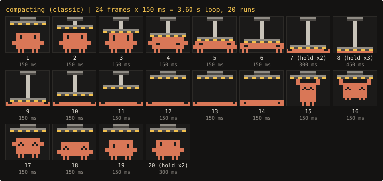
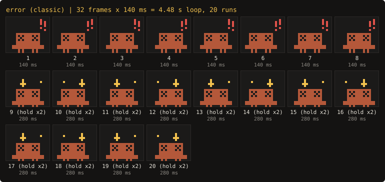
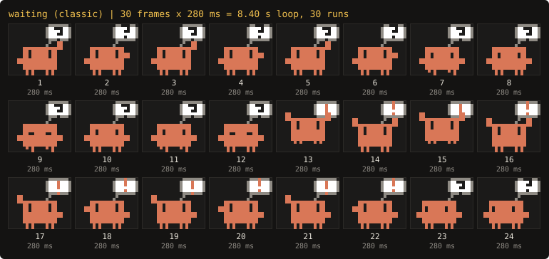

# Studies of our own animations

> **Read when:** you want to learn from what Clawd already does, or you are about to judge it. **Related:** [state language](state-language.md) · [review protocol](../practice/review-protocol.md)

These are *observations and open questions*, not change requests. The artwork is good and well-built; the goal here is to see **why** it works, so new looks can borrow the reasons. Where a note reads like a critique, treat it as a hypothesis worth a look, not a verdict. Data are computed from `crew-sprites.js`; figures are generated from its real frames (see [examples/](../examples/)).

## What's working, and why

### 1. A single body with a state grammar
The same 12x8 orange block carries 17 moods and 71 looks. One prop, one claw pose, one eye state, one tempo per look. This is Mario's cap (a fixed slot) plus Animal Crossing's shared emotional grammar plus Tamagotchi's shared skeleton, and it's why a roster this large still feels like one character. See [state language](state-language.md).

### 2. Tempo is already mood
Sleeping 500 ms, thinking 350, typing 250, error 140, done 130, running 110: slow to fast tracks calm to frantic with no extra frames ([timing](../foundations/timing-and-spacing.md)).

### 3. The idle is a score, not a loop
Breath, glance left (×3), glance right (×3), one-beat blink, shuffle step, **stretch** (rare), settle, foot taps, ending on the starting pose. Different periods, one rare event, a clean loop seam ([idles](../foundations/idles-loops-and-aliveness.md)). And an explicit design rule in a code comment: idle never waves or hops.

### 4. Done is a textbook hop
Anticipation squash, launch with decelerating gaps (2, 2, 1 rows), contact squash, then a moving hold where only the sparkles change ([weight & impact](../foundations/weight-and-impact.md)).

### 5. Compacting is a full little story

A press descends (eyes look up, then go wide: **notice**), squashes him (the engine's squash steps: 2, 4, 5, then lie 6, 7), holds flat for several beats under a held plate (**the pause is the joke**), the plate lifts, one "dot" eye opens, he stretches up with arms raised and happy eyes (**payoff**), settles, and looks up again. Setup, escalation, hold, payoff, reset, in 3.6 s. The deep squash gives up volume on purpose (area falls from 96 to under 30 at the flattest): a comic exception to the volume rule, and a good one because the *joke* is that he's flattened.

### 6. Error is state-by-tint, and it stays kind

The body darkens to the shade colour (contrast to normal body 1.53:1, so he reads as the same crab, but dim), eyes go to x's, claws hang down, he wobbles ±1 px, and two accents do the signalling: red "!!" first, then two yellow sparkle-stars that circle. Humiliated, not hurt. Colour is not the only signal (shape and motion change too).

### 7. Waiting escalates

"?" with a claw wave, a look-around, then "!" with hops and claws up, then back to "?" looking left and right. It starts polite and gets more insistent within one 8.4 s loop, which is the Tamagotchi attention call in animation form, and uses the reserved "hop" vocabulary correctly.

### 8. Humor lives in calm and failure states
The cheeky looks (a raspberry, a wiggle with his back turned, a flex) sit in waiting, error, done and running: states where people are either calm or already looking. They are brief and keep Clawd sheepish or proud rather than pained.

## Open questions (look, then decide)

1. **Eye height.** Default eyes sit in rows 2-3 of 8, above the body's midline. Baby-schema advice puts them lower; moving them down a row would read sleepier and younger. Which does he want to be, alert or soft? (Try it in a scratch render and look; the answer may be "leave it".)
2. **Blink length.** Blinks are one frame, which in a 260 ms animation is 260 ms: slower than the 80-150 ms often suggested (UNVERIFIED as a target). That might be just right (a relaxed, sleepy blink) or a hint of heaviness. Does any state want a *snappier* blink? That would need a shorter quantum or a faster idle loop.
3. **Equal-beat typing.** The typing loop alternates claws on exact 250 ms beats for runs of 8 and 6 frames. Typing *is* regular, so that might be perfect; the unequal pauses (a held beat, eyes lifting) between runs are what make it human. Would an irregular burst-pause pattern read more like a person?
4. **Silhouette overlap.** In the modal frames, responding/waiting overlap 0.94, typing/reading 0.91, idle/reading 0.91 (see [silhouette](../foundations/silhouette-and-readability.md)). They're told apart by glyph, prop and motion rather than shape. Is that enough in peripheral vision at 1x? A one-second look from across the room would tell.
5. **Light themes.** Body on white is 3.12:1 with no outline. Does Clawd hold up on a white terminal? A sel-out or an inside outline on the shade colour would be the first things to try, if it's ever a problem.
6. **Loop vs. persistence.** "Done" is a 1.3 s loop. If it stays on screen for a long time, a 1.3 s celebration repeating forever may start to feel like a tic, depending on how long the state is shown. Worth watching in real use.
7. **Quantum granularity.** One ms per animation limits how fine the timing can be. A mixed pace (a slow breath with a quick blink) is only possible via repeated frames at the base quantum. Worth knowing before inventing something that needs fast and slow in the same loop.
8. **The roster is big.** With 71 looks, which are the *signature* ones people remember? A KB-style test: could someone sketch Clawd's three best looks from memory? If not, those might deserve the most polish.

## Learning exercises from the catalogue

- Pick a look, write its **score** like the idle table in [idles](../foundations/idles-loops-and-aliveness.md#look-at-it).
- Pick two looks and swap their **tempos**: what changes? (A good test that tempo carries mood.)
- Pick a look and **delete its prop** in a scratch copy: what does the pose still say?
- Find the **rare gesture** in three looks. Is there one in every look? Should there be?
