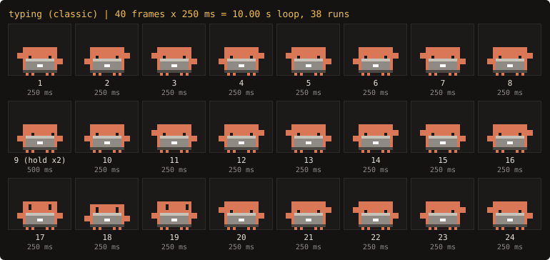

# Body language and props

> **Read when:** the face isn't enough, and the body, the claws or a held object has to say what Clawd is doing. **Related:** [silhouette](silhouette-and-readability.md) · [faces & eyes](faces-and-eyes.md) · [storytelling & humor](storytelling-and-humor.md) · [clawd/state-language](../clawd/state-language.md)

*A lens, not a law: everything below is a default with a reason. Break it on purpose when you have a better idea, and say why.*

## The question

*What does the body say that the face can't, and what is the least I can hold or wear to say the rest?*

## Why it works

- **Posture is the cheapest emotion channel after the eyes.** Four dials do most of the work (synthesis from Pixnote, Spritegen, Piximelon and the animation sources):
  - **height**: body drops 1 px = tired or sad; rises = excited or proud
  - **tilt/lean**: forward = effort or curiosity; backward = surprise
  - **limb position**: claws up = cheer or alarm; down and together = calm or sad; one raised = greeting or a question
  - **squash**: wide-and-flat = relaxed or heavy; tall-and-narrow = alert
- **Weight is perceived from timing**: heavy things ease in and out; light things pop. Body language is partly a timing problem ([timing](timing-and-spacing.md)).
- **Limbs read when they contrast with the body, or break the silhouette.** Mario's overalls over a different-coloured shirt made arm swing readable across about three frames, and his white gloves made hand motion visible (Iwata Asks). Clawd's claws are the same orange as his body, so they read by *protruding from the silhouette* and by position, not by colour; see the tension below.
- **A prop is a stand-in for a whole scene.** The viewer completes the story from one object with an obvious function (Navarro's single "frozen moments"; eBoy's dense object inventories; Mario's cap). The cost is a few pixels; the payoff is a state that reads at 1x. The rule: the prop must pass the shadow-only silhouette test (Neta Studio). If it needs a label it's wrong.
- **Costumes and props sit on slots.** Mario's cap sits on the head slot and replaces hair; Clawd's hats (khăn đóng, Santa, party, pumpkin, nightcap) sit on the same slot and leave the body untouched, so identity survives.

## Look at it

Clawd's existing prop vocabulary, from the engine and [docs/PETS.md](../../PETS.md): thought cloud with dots or a bulb (thinking), speech bubble with growing lines (responding), laptop (typing), book/paper/tablet (reading), flashlight/binoculars (searching), terminal window/treadmill/progress bar (running), hammer/toolbox (tooling), sign/bell (waiting), trophy/confetti (done), smoke/rain (error), vacuum/broom (compacting), small Clawds as crowds (rallying, delegating).

Pattern: **each state = one prop + one claw pose + one eye state + one tempo**, on the same body. That is the "state grammar" and it works; see [state-language](../clawd/state-language.md). Community Clawd projects arrived at the same conclusion (clawd-tank, clawd-on-desk), a sign the grammar is natural for this character.

In the typing loop the laptop (its grey lid in front of Clawd, his eyes peeking over the top) is a static silhouette; the story is two alternating claw poses at its edges, a held beat, and a moment where the eyes go wide (a glance at the screen). *The prop is held still while a small body part moves.* That "stable prop, moving claw" split is why it reads.

## In practice

1. **Choose the verb first.** Tap, snip, wave, hold, lift, juggle, point. Claws are Clawd's verbs; the prop is the object of the verb.
2. **One prop per state; one asymmetry per frame.** A second prop usually halves the first one's readability (WigglyPaint: "five details" makes it unreadable).
3. **Test the prop alone in shadow.** Binoculars and a trophy are great shadows; a "document" is a grey rectangle and needs a corner fold or lines to be anything.
4. **Hold the prop still; move the claw.** Anchoring the big shape and animating the small one keeps the silhouette stable and the motion legible (Pixel Overload / PiXiMelon: layer moving parts over a shared static layer).
5. **Reuse a small kit across states.** eBoy's Peecol bricks and Kare's metaphors show that recombining a small modular kit yields many stories while keeping the style coherent. Established signs beat invented ones: a sparkle for done, zZz for sleep, a sweat drop for effort. Kare borrowed the Command symbol from Swedish campground signs rather than inventing one.
6. **Let the prop come and go in a way that tells the story.** The hat appears with the season; the cloud grows dots as thinking continues; the progress bar fills. A prop that *changes* is a clock.
7. **Don't let props break the silhouette so badly that the creature disappears.** Big props (the 10-wide laptop) are fine because the body is still the largest mass.

## Tensions

- **Contrast between limb and body vs identity colour.** Mario's contrasting sleeves read motion; Clawd's single-hue body doesn't offer that. A claw tint would help motion legibility but cost the one-hue identity. Position and protrusion already read; weigh before changing.
- **Readable prop vs cluttered band.** The band is small and next to gauges; a large animated prop competes with them. Prefer props that stay inside the sprite's own cell.
- **Prop vs pose.** If the prop does all the work, the character is a mount for it. Aim for a pose that still hints the state with the prop covered.

## Ask yourself

- If I cover the prop, does the pose still hint at the verb?
- If I cover the claws, does the prop still tell the story?
- What is the single thing I want the viewer to notice, and is it the biggest or highest-contrast thing?
- Could an established sign do this instead of a new one?

## Sources

[Iwata Asks: Mario's overalls](https://www.nintendo.com/en-gb/Iwata-Asks/Iwata-Asks-New-Super-Mario-Bros-Wii/Volume-1/2-The-Reason-Mario-Wears-Overalls/2-The-Reason-Mario-Wears-Overalls-210759.html) · [Neta Studio 16x16 rules](https://neta.art/blog/16x16-pixel-art-rules) · [WigglyPaint animation guide](https://wigglypaint.com/blog/pixel-art-animation-guide/) · [eBoy interviews (TOYSREVIL)](https://toysrevil.blogspot.com/2007/09/of-pixels-and-peecols-interview-with.html) · [Priceonomics on Susan Kare](https://priceonomics.com/the-woman-behind-apples-first-icons/) · [clawd-tank](https://github.com/marciogranzotto/clawd-tank) · [clawd-on-desk](https://github.com/rullerzhou-afk/clawd-on-desk) · [Pixnote](https://pixnote.net/en/learn/character/). Prop inventory from `crew-sprites.js`. [references](../references.md).
