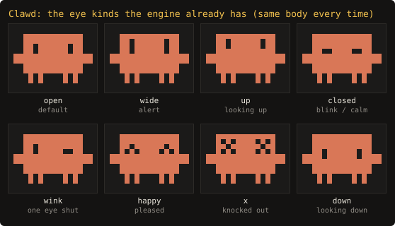
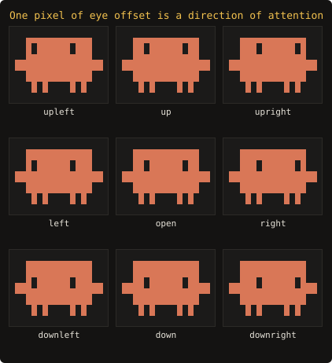

# Faces and eyes

> **Read when:** giving a sprite an expression, a gaze, or a blink. **Related:** [character & appeal](character-and-appeal.md) · [idles & aliveness](idles-loops-and-aliveness.md) · [clawd/state-language](../clawd/state-language.md)

*A lens, not a law: everything below is a default with a reason. Break it on purpose when you have a better idea, and say why.*

## The question

*How much can two to four pixels say, and what must stay still so that the rest can move?*

## Why it works

- **People read faces from a handful of high-contrast cues.** Two dark marks on a lighter field read as eyes almost regardless of context. Scott McCloud's argument (via secondary summaries) is that iconic faces invite projection: the viewer supplies the feeling. This is why Pac-Man has no eyes (Iwatani refused to add them, wanting each player to project their own), Hello Kitty has no mouth (designers say viewers read their own mood into her), and Gromit's whole acting range lives in two dots and a brow (Nick Park found it when dialogue was cut). Caveat: simplicity alone doesn't guarantee appeal; Tofugu notes other mouthless Sanrio characters flopped.
- **Eyes are the main instrument.** Pixeli's eye-size ladder by head height: 8 px head = 1x1 or none; 12 px = 1x2; 16 px = 2x2; 24 px = 3x3; 32 px = 5x4. The *shape* says something too: a vertical 1x2 eye reads young, open, alert; a horizontal 2x1 reads sleepy, flat or older; a highlight pixel in a 2x2 eye reads lively (Pixnote, Maglione, Pixeli 33). Placing eyes one pixel *lower* reads tired, and also younger and cuter (Piximelon; baby schema, see [character](character-and-appeal.md)).
- **One pixel of brow carries most of an emotion**, and a pupil dead centre on a front-facing head reads as a dead stare; shift it one pixel (Pixeli 33). Eyebrows are disproportionately informative: a face-recognition study (Sadr, Jarudi and Sinha 2003) is widely quoted as showing recognition dropping from ~60% to ~40% without brows, worse than removing eyes. UNVERIFIED here (only a search snippet was readable).
- **Keep spare pixels in the neutral face.** If the default expression already uses every available pixel, there is nowhere left to move for other emotions (sprite-ai).
- **Moving pixels say what stills can't.** Saint11, in a podcast, notes a two-pixel mouth can't convey laughter as a still, but moving pixels can. Expression is partly timing: see [timing](timing-and-spacing.md).

## Look at it

Clawd's engine already has a whole eye grammar, with the body unchanged:

| Eye kind | Pixels | Reads as |
|---|---|---|
| default | two 1x2 columns | calm, attentive |
| wide | two 1x3 columns | alert, startled |
| closed | two 2x1 bars | blink, content, asleep |
| wink | one 1x2, one 2x1 | cheeky |
| happy | a 3-pixel arch (^) per eye | pleased |
| x | a 3x3 cross per eye | defeated |
| up / down / left / right (+ diagonals) | the column shifted 1 px | where attention is going |

And the gaze grid: one pixel of offset is a direction of attention.

Observations worth keeping:

- **Clawd has no mouth and no brows.** That's the Hello Kitty / Gromit move: the eyes and the body carry everything. Every emotion has to be solved with eye shape, eye position, posture and props. Mouths do appear, but only as event-only accents: the yawn draws a dark gap for a few beats. Keeping the neutral face mouthless is what lets those moments land.
- **The eyes are the highest-contrast pixels on the sprite** (ink on orange is 5.5:1), exactly where the viewer should look.
- **The default eyes sit in the upper half of the 8-row body** (rows 2-3 of 0-7) with about two rows of body below them. Baby-schema advice puts eyes *below* the head's midline, so this is a place where Clawd leans more "alert robot" than "baby". Not a flaw; a lever you can see: lowering the eyes one row would read sleepier and younger. Test before judging.

## In practice

1. **Design the neutral face with room to move.** Then define a small fixed set of eye states and use them in every pose, in the Animal Crossing manner of a shared emotional grammar, so a new pose is readable the first time.
2. **Blink with one frame.** At 16 px and below a closed eye is 1 frame (Pixeli suggests 80-100 ms; at 24+ px, three frames of 50/80/50). Blink every 2-4 s, on a period different from any breathing loop, and not during an intense task (Piximelon; research notes). Squash the eyes, don't redraw them.
3. **Use gaze as story.** A 1 px shift reads as attention (clawd-on-desk implements actual eye tracking; Pac-Man ghosts' pupils lean toward travel direction, which is easy to verify in an emulator but not stated in the sources I could open). Look at what you're about to do: eyes up-left while thinking, down while reading or typing.
4. **Asymmetry on purpose.** Start symmetric, then break it in exactly one place (a raised brow, a wink). At 16 px accidental asymmetry reads as a glitch, so make it clearly intentional (Piximelon; Pixeli 33).
5. **When a mood can't be shown with eyes, add a prop** instead of a feature. Disgust is hard without a nose to wrinkle, so emoji designers add vomit; Clawd can add a sweat drop, a "?" or a cloud (Ozel, emoji design).
6. **Don't alarm when you only mean to inform.** Icons are read literally: Susan Kare's bomb for fatal errors made a customer phone Apple fearing the machine would explode. See [studies/susan-kare-icons](../studies/susan-kare-icons.md).

## Tensions

- **Blank vs legible.** A blank default lets viewers project, but a status mascot has to *state* its state. Resolve by letting posture and props carry the state and keeping the face a mood mirror.
- **Bigger eyes = cuter, until alien.** The relationship likely has an optimum, not a trend (the relevant paper couldn't be read: UNVERIFIED). Test visually.
- **Symmetry as calm vs life.** Symmetric eyes feel stable; a one-pixel offset feels like thought.

## Ask yourself

- With the body hidden, what does the face say? With the face hidden, what does the body say? Do they agree, or is the mismatch the joke?
- Did I leave myself one spare pixel to move?
- Is this blink metronomic?
- Where is the viewer looking, and where am I telling them to look?

## Sources

[Pixeli 33 Eyes and expressions](https://pixeli.pebbly.space/knowledge/rules/33-eyes-and-expressions) · [Piximelon: Pixel Art Faces](https://piximelon.com/guides/pixel-art-faces/) · [Maglione: pixel art eyes](https://www.sandromaglione.com/articles/pixel-art-eyes-techniques-and-styles) · [Pixnote: characters](https://pixnote.net/en/learn/character/) · [sprite-ai: anime pixel art](https://www.sprite-ai.art/blog/anime-pixel-art) · [Tofugu: Hello Kitty's blank face](https://www.tofugu.com/japan/hello-kitty-face/) · [OPENERS: Iwatani interview](https://openers.jp/en/design/design_features/4CoXi) · [Animation Obsessive: Wallace & Gromit](https://animationobsessive.substack.com/p/wallace-and-gromit-90-alone) · [Ozel: emoji design](https://melindaozel.com/mindful-design-everything-you-did-and-didnt-want-to-know-about-emoji/) · [clawd-on-desk](https://github.com/rullerzhou-afk/clawd-on-desk). Eye geometry from `crew-sprites.js`. [references](../references.md) · [raw notes](../research/character.md).
