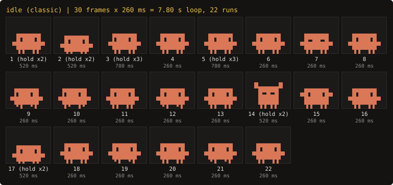
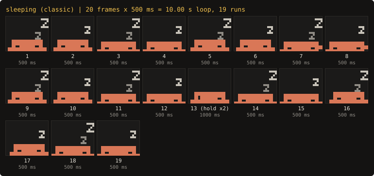
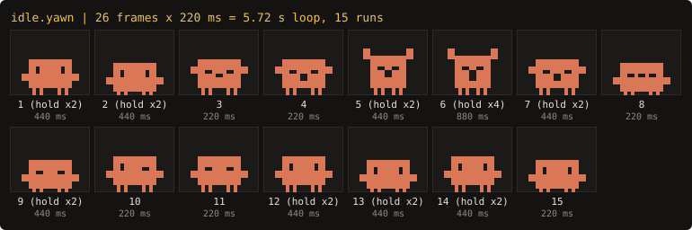

# Idles, loops and aliveness

> **Read when:** a creature stands still and has to feel alive, or a loop feels mechanical. **Related:** [timing](timing-and-spacing.md) · [weight & impact](weight-and-impact.md) · [companion presence](companion-presence.md)

*A lens, not a law: everything below is a default with a reason. Break it on purpose when you have a better idea, and say why.*

## The question

*What makes a sprite doing almost nothing feel like it's alive, and what makes it feel like a machine?*

Most of the time Clawd is idle or in a slow state. An idle is its personality on a loop, so this module might matter more than all the dramatic animations put together. Players rarely notice a good idle but notice if it's missing (Sprite AI).

## Why it works

**Alive when** (synthesis of the animation sources, with the reasoning):

1. **Durations are unequal**: a hold on rest, brief on the peak. Equal durations are a 50/50 toggle and read as a machine.
2. **Parts move on different periods or lag by a frame.** If a breath, a bob and a blink are all on the same clock, they read as one mechanism; offset them. PiXiMelon's recipe: pick two of {breath, bob, blink} and put them on different periods; blink every 2-4 s, not on the breath peak.
3. **The motion has a reason** (breath, weight shift, attention) that matches the state.
4. **There is a rare event** (a blink, a twitch, a gesture) so the loop isn't perfectly periodic. Gen 5 Pokémon had a common idle played several times plus a rare one so repeated viewing doesn't go stale (Oripoke).
5. **The delta is small and located on a feature that reads as intentional** (an eye, a claw tip), not the whole sprite jumping as a rigid block.
6. **Volume is preserved** if the shape is deformed.

**Mechanical when:** equal durations; the whole sprite moves as one block; everything on one clock; amplitude too big (a pogo-stick idle; "don't bounce too much"); distortion without volume conservation; no anticipation or settle.

**Idle recipes that agree across sources.** 2-frame: body down 1 px for 500-600 ms, up for 400 ms, with an appendage moving 1 px the other way. 3-4 frame: rest, inhale/peak, return, optional settle, at 4-6 fps, holding the first frame a little longer so it feels relaxed and not twitchy. Everything stays 1 px. Keep feet planted; animate the upper body. Build idle, walk and hit from one shared rest pose so transitions are seamless.

**Loops.** The last frame should flow into the first: end on the start pose, or use symmetric motion. A ping-pong (1-2-3-2) reuses frames, gives perfect turnarounds and is naturally eased. Looping exposes every orphan pixel and badly-clustered shape (Slynyrd): clean pixels matter more in animation. The seam only shows in motion, so preview at speed.

**Moving hold.** A pose you need to hold gets a 1 px breath, a blink or a micro-shift. Williams' warning stands: a hold needs a reason (thinking, waiting, listening).

## Look at it

Clawd's classic idle is 30 frames at 260 ms = 7.8 s, built from 22 runs of repeated frames. Read it as a score, not a loop:

The score, read from the engine's own frame list (`crew-sprites.js`; its comment calls it "waiting for a prompt, but not still"):

| Beats (260 ms each) | What happens | Why it's there |
|---|---|---|
| 1-2 | rest | the home pose, held |
| 3-4 | body sinks one row (a breath) | the moving hold |
| 5-7 | eyes glance left, held 3 beats | attention drifting |
| 8 | rest | a beat between looks |
| 9-11 | eyes glance right, held 3 beats | the other way |
| 12-13 | rest, then **one beat of closed eyes** | the blink, mid-loop and off the breath beat |
| 14-18 | a shuffle step to the left, legs alternating, then back | weight shift, a bit of travel |
| 20-21 | **stretch**: body taller, both claws up, eyes shut (held 2 beats) | the rare gesture that breaks the rhythm |
| 22-30 | settle, breathe, a couple of foot taps | return to rest so the loop closes |

Why it works: nothing repeats on the same clock (breath, glances, blink, step, stretch all have different spacing); there is one **rare gesture** (the stretch), and the loop **ends on the pose it started from**. The engine's comment adds a design rule: *no wave or hop in idle, since those mean "needs you" and "done"* (see [state-language](../clawd/state-language.md)). Eight of the loop's 21 pixel-changing transitions change four or fewer pixels: the micro-moves that keep a still sprite breathing.

That's the Pokémon common/rare structure and the moving-hold principle done in one file. The rest of the idle family is the same idea in costume: coffee, humming, yawn, scuttle, stretch, water.

Compare the **sleeping** loop: 500 ms per frame, 20 frames, slow 1 px breathing of a flattened body while a pair of zZz drift up and fade (they are why every transition changes 22+ pixels, though the body barely moves). Near the middle, one frame (held 1 s) opens a single sliver of eye, a dream flicker:

And the **yawn**, a small story with a beginning, build and release: eyes narrow, the body stretches taller with both claws up and a dark gap for a mouth (held ~0.9 s at the peak), then eyes drop to slits and slowly reopen:

## In practice

1. **Write the idle as a score** in beats: when does the breath dip, when does the blink land, when does the rare gesture happen. Offset the periods deliberately (e.g. a 4-beat breath, a blink every ~11-15 beats).
2. **Use odd intervals.** Randomise or vary blink intervals a little so they don't metronome (an inference consistent with the offset-period advice). In an engine with fixed loops, vary by **loop length**: two loops of different lengths playing in sequence give you free irregularity.
3. **Common and rare.** Let the idle play several times, then an occasional variant (a claw clack, a look-around, a tiny yawn). Cheap and effective in a status band that people look at all day.
4. **Tempo as data.** Change the beat length with state (idle 600 ms, busy 300 ms) instead of adding frames: zero pixels. Pokémon's party icons moved less energetically at low HP.
5. **Don't blink during intense tasks.** Attention is on the work. Blink in rest and thinking, not in typing bursts.
6. **Drop idles that grab focus.** Clippy's idle taps were meant to make it feel alive and ended up distracting. An idle is for the corner of the eye. See [companion presence](companion-presence.md).
7. **Sub-pixel tricks exist but need spare tones.** Moving a highlight 1/2 px inside a fixed silhouette gives slower-than-1px motion, but it needs at least 2-3 tones in the area; with a 4-colour palette there may be none to spare.

## Tensions

- **Alive vs distracting.** A busier idle is more alive and more annoying. The peripheral-vision test: can I stop noticing it?
- **Randomness vs predictability.** Random events keep it alive, but an unpredictable flinch at the wrong time breaks trust. Cooldowns and probabilities (Mochi's approach) beat timers.
- **Fixed quantum vs a precise blink.** A 260 ms frame makes the blink longer than the ~80-150 ms usually suggested (an UNVERIFIED inference; no source gave per-blink milliseconds). Whether that reads as a slow, relaxed blink or a sleepy one is for eyes to judge.

## Ask yourself

- What changes in the idle, and what is *guaranteed not to*?
- Which two things move on different clocks?
- What is the rare event, and how rare is it?
- Could I stop noticing this after ten minutes? Should I?

## Sources

[PiXiMelon: idle animation](https://piximelon.com/guides/pixel-art-idle-animation/) · [Sprite AI: how to animate pixel art](https://www.sprite-ai.art/guides/how-to-animate-pixel-art) · [JIK-A-4: idle cycle tutorial](https://itch.io/blog/559673/pixel-art-idle-cycle-animation-tutorial) · [Oripoke](https://oripoke.wordpress.com/2025/06/21/how-to-make-animated-pokemon-sprites/) · [Slynyrd Pixelblog 8](https://www.slynyrd.com/blog/2018/8/19/pixelblog-8-intro-to-animation) · [Tiny Warrior Games: sub-pixel animation](https://tinywarriorgames.com/2019/01/04/game-development-pixel-art-sub-pixel-animation/) · [Wikipedia: Twelve basic principles](https://en.wikipedia.org/wiki/Twelve_basic_principles_of_animation) · [Mochi (DEV)](https://dev.to/mikachu/a-tiny-linux-desktop-companion-and-wayland-and-gtk-kept-getting-in-the-way-4lbi) · [Pixeli 41 Idle and breathing](https://pixeli.pebbly.space/knowledge/rules/41-idle-and-breathing). Frame analysis computed from `crew-sprites.js`. Saint11's idle tutorials are Patreon-gated and known only from snippets (UNVERIFIED). [references](../references.md) · [raw notes](../research/animation.md).
