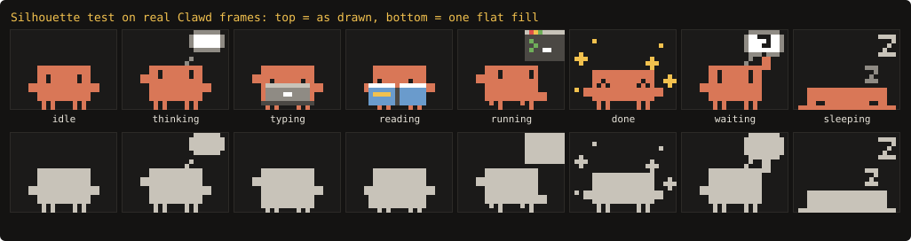

# Pixel economy

> **Read when:** you are deciding how much to draw, what to leave out, or why a sprite feels fussy or empty. **Related:** [silhouette](silhouette-and-readability.md) · [faces & eyes](faces-and-eyes.md) · [studies/mario-16x16](../studies/mario-16x16.md)

*A lens, not a law: everything below is a default with a reason. Break it on purpose when you have a better idea, and say why.*

## The question

*What is each pixel for?*

At 8-32 px you are not drawing a crab, you are choosing which five or six facts about a crab survive. Derek Yu puts it as the smaller a sprite gets, the more each single pixel is responsible for what the thing is. Pedro Medeiros (Saint11) calls tiny pixel art a puzzle where every pixel has to carry meaning, and says low resolution forces you to select what to show and let the viewer's imagination do the rest.

## Why it works

- **Detail dilutes the one signal that matters.** At small sizes every extra cluster competes with the silhouette for attention. More detail doesn't add information; it blurs the information you had. Pixeli's size ladder is a good feel for the trade: at **8 px** one icon, one idea, one dark pixel can be an eye; at **16 px** a readable character with one focal detail and roughly 4-8 colours; at **32 px** a suggested face and 10-15 colours; at 48+ the risk flips from too little room to too much noise.
- **The viewer closes the gap.** Scott McCloud's "amplification through simplification" (as summarised by secondary sources) says that simpler, iconic faces invite identification, and the mind will project a face onto almost any dot-dot-line pattern. Fewer pixels hand more of the work to the viewer, which can make a character *more* personal, not less. Raymond Schlitter (Slynyrd) re-did his 16x16 tiles at 8x8 with little loss and argues that adding detail until the pixels stop mattering is how pixel art turns into digital illustration done through a pixel process.
- **A good stand-in beats a bad copy.** When Miyamoto could not afford hair or a mouth on a 16x16 Mario, he bought one high-contrast shape for each: a cap and a moustache. Both read better than a few mushy real features would have. See [Mario](../studies/mario-16x16.md).

## Look at it

How much of Clawd is "face"? The body is 12x8 (96 px), the arms 2x2 each, the legs 1x2 each: about 112 pixels in total. The default eyes are two 1x2 columns: **4 pixels, about 3.5% of the figure**, and they carry every emotion in [the face vocabulary](faces-and-eyes.md). Everything else is posture, props and time.

A 1 px outline is not free either: on a roughly 12x14 figure inside a 16x16 canvas it eats about 50 of 196 usable cells, around 30% (Neta Studio's arithmetic). Clawd has no outline at all. See [value, colour & outline](value-color-and-outline.md).

## In practice

1. **Fix the budget first**: canvas size, palette size, outline style (or none), light direction, view. Pixeli rule 00 asks for these five decisions before the first pixel.
2. **Decide what must be read at a glance** (the state, the direction of attention, the prop) and spend there. Saint11's Celeste example: for Theo he kept beard, hair, scarf and backpack because they said who he was, tilted the torso back one pixel for a relaxed posture, and dropped headphones, pockets and face detail.
3. **Replace costly features with one-shape stand-ins.** A coffee mug is a light block and a dark crescent, not a rendered mug. A keyboard is a thin grey bar and alternating claw dips.
4. **Let motion and context imply.** Saint11 notes animation can rely on the viewer's memory: you never draw the water from the watering can, the flower reacts. A claw dipping next to a grey bar implies typing without drawing keys.
5. **Prefer redrawing to resizing when you change budget.** If a detail doesn't survive a smaller canvas, it didn't carry its weight; the face is usually the first casualty, so rebuild from the smallest important detail outward (ghostboy's method: shrink the face until it only just works, then build the body around it).
6. **Stop early.** Slynyrd and Derek Yu both warn that the grid invites endless fixing. Step away; a sprite is finished when removing a pixel hurts.

## Tensions

- **Ambiguity vs vagueness.** Ambiguity is a feature (viewers complete the image); vagueness is when the remaining cues are the wrong ones. Random pixels near the face are the commonest cause. Each pixel should mean something even if you can't say exactly what (Saint11).
- **Spare pixels vs state.** If the neutral face already uses every pixel it can afford, there is nowhere left to move for other emotions (sprite-ai's advice, consistent with Clawd's design: a 1x2 eye can collapse to 1x1 for a blink or grow to 1x3 for alarm).
- **Detail that carries meaning is worth it.** Saint11 broke his own no-dither habit for a texture that said "flannel shirt". Cut detail that decorates, keep detail that tells.

## Ask yourself

- If I delete this pixel, what does the viewer stop knowing? If the answer is "nothing", delete it.
- Which feature am I spending on because it's easy to draw rather than because it's important?
- Have I looked at it at 1x, not just zoomed in? (Zoom lies: see [silhouette & readability](silhouette-and-readability.md).)
- What is the cheapest stand-in for the thing I can't afford?

## Sources

[Derek Yu, Pixel Art Tutorial](https://www.derekyu.com/makegames/pixelart.html) · [Saint11, My Thoughts on Very Low Resolution](https://saint11.art/blog/thoughts_on_low_resolution/) · [Slynyrd, Pixelblog 47 Tiny Pixels](https://www.slynyrd.com/blog/2023/11/26/pixelblog-47-tiny-pixels) · [Pixeli rules 00, 14, 30](https://pixeli.pebbly.space/knowledge/rules/00-core-principles) · [Neta Studio, The Rules of 16x16 Pixel Art](https://neta.art/blog/16x16-pixel-art-rules) · [Iwata Asks: Mario's overalls](https://www.nintendo.com/en-gb/Iwata-Asks/Iwata-Asks-New-Super-Mario-Bros-Wii/Volume-1/2-The-Reason-Mario-Wears-Overalls/2-The-Reason-Mario-Wears-Overalls-210759.html) · McCloud via [Wikipedia: Understanding Comics](https://en.wikipedia.org/wiki/Understanding_Comics). Full list and trust grades: [references](../references.md). Raw notes: [research/pixelcraft.md](../research/pixelcraft.md).
