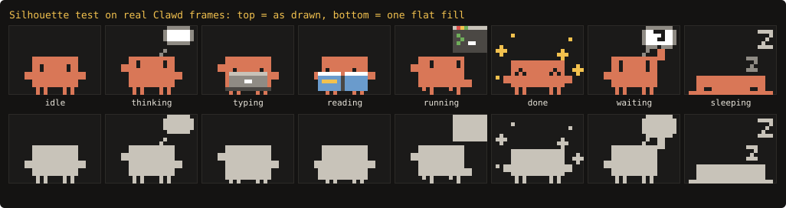

# Silhouette and readability

> **Read when:** a sprite looks fine zoomed in but mushy in the band, or you need two states to look different. **Related:** [pixel economy](pixel-economy.md) · [body language & props](body-language-and-props.md) · [review protocol](../practice/review-protocol.md)

*A lens, not a law: everything below is a default with a reason. Break it on purpose when you have a better idea, and say why.*

## The question

*Does it read at 1x, in peripheral vision, in under a second?*

Clawd lives in a status band beside a terminal. People see it out of the corner of their eye, at native size, on a background they chose. That is the hardest viewing condition there is for pixel art, and the one the sprite must be judged in.

## Why it works

- **At 8-32 px the outline *is* the information.** There is almost no interior to carry identity, so the silhouette carries nearly everything (Pixeli rules 03 and 36). The flat-fill test follows: fill the sprite with one colour at 1x. If you can't name the subject, change the shape.
- **Shape, then value, then hue.** Derek Yu's checks (squint, flip horizontally, desaturate) and Pixeli's test battery all enforce this order: if the flat silhouette fails, shading can't rescue it; if greyscale is muddy, no hue fixes it.
- **Zoom lies.** Detail that looks right at 800% disappears at native size. Pixnote shows anti-aliasing previewed at 16x beside actual size to make the point; Tsubu notes problems at 100% that look fine at 800%. Judge at 1x, look away for a few seconds, look back.
- **Motion changes the maths.** On a 20 px sprite 1 px is 5% of the width; on a 100 px sprite it is 1%. Pixeli rule 14 therefore asks for key differences of 2 px or more on the parts that matter, and notes that limb thickness drifting by even 2 px between frames is obvious in motion.

## Look at it

Real frames from our engine, top row as drawn, bottom row filled with one flat colour:

Things the flat row tells you:

- The **body is the constant**. Idle, thinking, typing, reading and running share the same 12x8 block; what separates them is the *prop* (a cloud, a laptop, a book, a terminal) and the claws. That is a deliberate and sound identity choice (see [character & appeal](character-and-appeal.md)), but it means state is read from the prop and the motion, not from the body shape.
- **Sleeping is the only state with a different body silhouette.** It flattens onto the ground and is the most distinguishable mood by far.
- **Props are doing silhouette work.** The speech cloud and the terminal window are big enough to survive the flat fill; that is why they read.

Measured on the engine (modal frame of each of the 17 base moods, overlap of filled pixels, 1.0 = identical): responding/waiting 0.94, typing/reading 0.91, idle/reading 0.91, thinking/responding 0.87. Sleeping vs. searching, planning, rallying and compacting is about 0.25. High overlap isn't a flaw by itself, as these states *also* differ in motion and eyes, but it tells you which pairs lean on something other than shape. See [studies of our animations](../clawd/studies-of-our-animations.md).

## In practice

1. **Run the flat-fill test on the worst pose, not the best.** One colour, 1x, 5 seconds, can you name it? Then: 50% size, then flipped.
2. **Make each state change the outline, not just the interior.** A pose that only changes eye pixels is invisible in peripheral vision. Cheapest silhouette levers for Clawd: claws up/down/forward, body height, one prop of readable size, flattened vs upright.
3. **Three different masses.** Head/torso/legs (or here body/claws/legs) should be clearly different sizes, since equal steps read as a snowman (Pixeli 36). Clawd's 12x8 body, 2x2 arms and 1x2 legs are distinct masses.
4. **Mind tangents and gaps.** Outlines that merely touch fuse into one blob; overlap decisively or leave a 1 px gap. A 1 px gap between legs is part of the shape (Clawd's four legs are separated by 1 px gaps, which is why they read as legs and not a skirt).
5. **Break symmetry once, on purpose.** Perfect symmetry reads like a statue or chess piece (Pixeli 03; Neta). One raised claw or one different eye is the cheapest character you can buy. Exceptions: surprise, a stable calm default.
6. **Props must survive as shadows.** Test each prop as a flat shape on light and dark. If it needs a label, it probably isn't working yet. Keep text out of sprites.
7. **Size is a cue.** Hero ~24-32 px, pet/minion ~12-16 px, boss 64+ (Pixeli 14). In our band the "small Clawd" crowd (5x3 bodies) reads as *other* because of scale alone.
8. **Check on a dark and a light background**, and on a real crop of the band. A value that reads on one can vanish on the other (see [value, colour & outline](value-color-and-outline.md)).

## Tensions

- **Constant body vs distinct silhouettes.** A mascot needs a stable identity *and* legible states. Resolve by varying one part per state while keeping the invariant (Kirby keeps eye spacing fixed while the body squashes).
- **Symmetry vs stability.** Symmetric stance feels calm and reassuring; asymmetry feels alive. Use symmetry as the resting default and asymmetry as the event.
- **Silhouette vs latency.** A big prop reads better but takes time to draw in and out; for fast-changing states (tool calls flick by) prefer one-frame-readable cues.

## Ask yourself

- Can I describe the silhouette in one noun-verb phrase ("crab holding a cup")? If it's just "orange rectangle", it isn't doing its job.
- Which of these two states would I confuse if I only saw them for half a second?
- Is the thing I'm proud of visible at 1x?

## Sources

[Pixeli 03 Silhouette and form](https://pixeli.pebbly.space/knowledge/rules/03-silhouette-and-form) · [Pixeli 14 Readability and scale](https://pixeli.pebbly.space/knowledge/rules/14-readability-and-scale) · [Pixeli 36 Character design](https://pixeli.pebbly.space/knowledge/rules/36-character-design) · [Derek Yu](https://www.derekyu.com/makegames/pixelart.html) · [Neta Studio 16x16 rules](https://neta.art/blog/16x16-pixel-art-rules) · [Pixnote](https://pixnote.net/en/learn/outlines/) · [Tsubu](https://tsubu.art/blog/pixel-art-color-palettes). Overlap numbers were computed from `crew-sprites.js` for this KB. [references](../references.md) · [raw notes](../research/pixelcraft.md).
