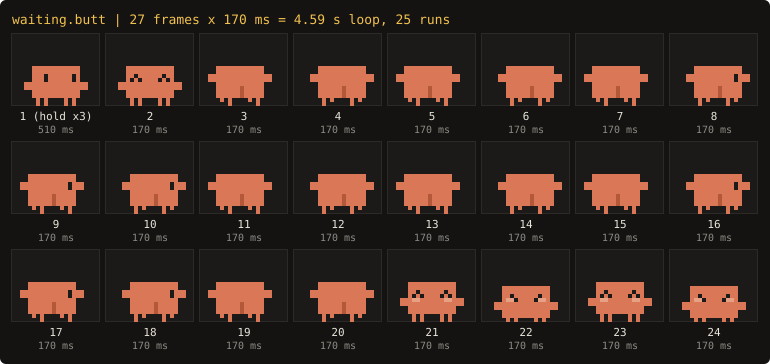
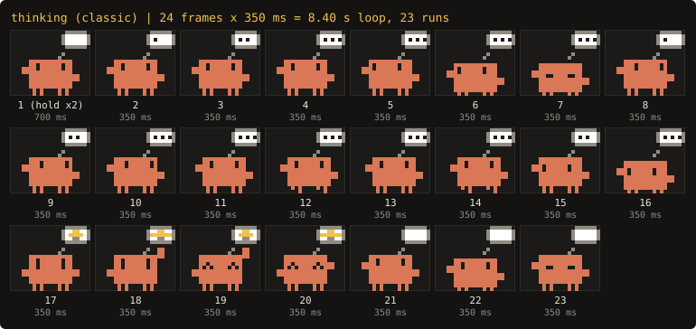

# Visual storytelling and humor

> **Read when:** inventing a new animation, a gag, or an error state; or when something is technically fine but has no spark. **Related:** [body language & props](body-language-and-props.md) · [timing](timing-and-spacing.md) · [clawd/gag-garden](../clawd/gag-garden.md) · [studies/constraints-as-character](../studies/constraints-as-character.md)

*A lens, not a law: everything below is a default with a reason. Break it on purpose when you have a better idea, and say why.*

## The question

*How do I tell a joke or a story in 24x18 pixels and four seconds?*

You don't have room to *draw* a story, only to **cue** one. The viewer's brain finishes the picture. The craft is choosing the cue and the beat.

## Why it works

**1. A gag is a pattern plus a break.** Two beats set a pattern, the third breaks it, but the break must still *connect* to the pattern (Ken Levine). Specifics beat generics; telegraphing kills surprise; the laugh goes last (Chris Head). Two beats are too few to lock a pattern, and four without a turn is repetitive (ScreenWeaver). Mapped to frames: frame 1 = pattern (a claw taps), frame 2 = same, frame 3 = break (it taps something else, misses, or the key falls off). Or run the pattern across loops: taps twice per loop, and on the third loop hits the edge of the screen. These sources are about stand-up and screenwriting; the application to sprites is by analogy. Don't let the formula itself become predictable.

**2. The pause is the joke.** Jesse Bray's animation timing lesson: comic timing lives in pause, speed and reaction, and a gag can live or die on a few frames. In the coyote-off-the-cliff gag he runs off the edge, hovers, looks down, looks at the viewer, then falls; the **hold before the fall** is the joke. The exercise: hold a ball in the air for 6, 12 or 24 frames and see which is funniest; it depends on the drop. A three-beat acting skeleton from his acting lesson: **notice** (eyes shift, 1 frame), **think** (hold, no motion), **react** (claws). The hold is what reads as thinking.

**3. Deadpan is a contrast generator.** Buster Keaton's stone face against chaos is the cheapest high-yield joke there is (my synthesis; the Keaton sources I could open were thin on specifics, so details of individual gags are UNVERIFIED). In two pixels: Clawd's eyes stay two flat dots while the world misbehaves.

**4. Remove a channel and the rest becomes distinctive.** Gromit lost dialogue and Nick Park found the eyes and brow could carry him; Mario's moustache replaced a mouth. An eyes-only character can't lie, so every glance is information. Constraints on *behaviour* work too: Chuck Jones's Road Runner rules (no dialogue but "Beep-Beep", all gadgets from Acme, gravity is the Coyote's enemy, he's more humiliated than hurt) make every new gag legible immediately, so the surprise lives entirely in the variation. Michael Maltese said he'd never heard of the rules, so they may be Jones's later framework, not a studio-wide practice.

**5. Put the best jokes in failure states.** Susan Kare's Happy Mac, Sad Mac and bomb icons, and the Dogcow, show that the right place for humour is where users are tense: a crash, a print dialog. A metaphor that's slightly wrong in an endearing way (the Dogcow) is stickier than a clean one. Caveat: icons are read literally; the bomb scared a customer into phoning Apple.

**6. Humiliated, not hurt.** Comedy stays comedy when the character is embarrassed, not damaged (Jones). Clawd's error states can be sheepish (a puff of smoke, a rain cloud, tongue out) without ever looking in pain.

**7. Emoji teach compression then re-amplification.** A tiny face must stay readable, so sets use a restricted pool of interchangeable eyes, brows and mouths; after simplifying, designers *amplify* the expression so it still reads. One eye shape flips a joke: the hand-over-mouth face with smiling eyes is giggly; with open eyes it is shocked (Ozel). Test whether the viewer's reading matches yours; usage drifts from intent.

**8. A frozen moment implies a life.** Octavi Navarro's pixel scenes are single moments that hint at before and after; the incomplete action (a girl mid-preparation for a birthday) invites the viewer to supply the rest, the same mechanism as McCloud's closure. His games run twenty minutes or less, self-contained: scope as a creative constraint.

## Look at it

Our back catalogue already contains small stories. Two to read closely:

*Waiting, "butt" variant* (27 frames, 25 runs): Clawd glances sideways, a small happy-eyed flick, then turns his back on us, a plain orange block with a single darker crease, and keeps it turned for about three seconds before swinging round with a blush. Sulking and pretending not to look is the oldest gag in the book; here it works through the **change of silhouette (the face vanishes), a long held pause, and a payoff face (blush) at the end**. Cheeky, but clean.

*Thinking, classic* (24 frames, 350 ms): a thought cloud fills with dots one at a time while Clawd leans, hunches and shuts his eyes for a beat ("hmm"); then a yellow bulb lights in the cloud, his eyes go to happy arches and a claw pops up (the payoff); then the cloud clears and he settles back. It is a complete **setup, build, payoff, reset** in 8.4 s, and the crab stays modest while the cloud does the storytelling. (Compare rule 6 of the [gag garden](../clawd/gag-garden.md): calm face, eventful world.)

## In practice

1. **Write the gag in one sentence with a verb** ("the crab taps the key twice, then once on the edge of the screen"). WigglyPaint's "state the motion as one sentence and cut whatever doesn't serve it" is the same discipline. If you can't, the idea isn't ready.
2. **Verbs first, objects second.** For a crab: sidle, snip, peek, burrow, scuttle, tap, flinch, preen, bubble, juggle, nap. Pick the verbs that read in 1-3 frames, then find the prop. (Synthesis; not a sourced method.)
3. **Ask "what would it do if it were bored?"** Boredom loops are low-stakes and show personality (counts something, pokes the edge, mimics the cursor). Bray's four-panel wordless exercise (open gift, confusion, fake smile at socks) is a good format.
4. **Mine the constraint itself.** Thimbleweed Park joked about its own wireframe look; a crab walks sideways, so *forward* is the surprise; "claw" is also a grabbing command. Ambiguity is a source of misdirection (Chris Head's notebook of mismatches and accidents).
5. **One idea per frame (staging).** Make the idea completely and unmistakably clear and remove irrelevant detail (Thomas and Johnston, via Wikipedia). If the claw wave is the story, freeze the eyes.
6. **Establish, reinforce, subvert, then vary.** Use a **rare variant** every Nth loop for the surprise. Don't use subvert and escalate in the same unit.
7. **Playtest at real size, in the real context.** Detail visible only at 4x is wasted at 1x.

## Tensions

- **Joke vs interruption.** A gag that grabs attention at the wrong moment is Clippy. Put jokes in calm states (idle, sleeping) and failure states (where the user already looks), and keep them brief. See [companion presence](companion-presence.md).
- **Formula vs freshness.** The rule of three is a tool; if every gag is setup-reinforce-subvert, the formula becomes predictable.
- **Pause length.** A longer pause sharpens a gag but drains momentum if overdone; the sources give no hard frame limits. Test at the real tempo.
- **Edgy vs warm.** Cheeky variants (the repo has a few) are charming because they stay clean and brief; the test is whether you'd be happy for a colleague to see it over your shoulder.

## Ask yourself

- Where's the setup, the beat, the payoff? Where is the hold?
- Does the face stay deadpan while the world misbehaves?
- Is it humiliation or pain?
- Could someone get it in a second at 1x with the sound off?
- What am I willing to cut to keep the joke?

## Sources

[Retro-Replay: Mario's mustache](https://retro-replay.com/marios-mustache-was-a-hardware-trick/) (used cautiously) · [Animation Obsessive: Wallace & Gromit](https://animationobsessive.substack.com/p/wallace-and-gromit-90-alone) · [Mental Floss: Chuck Jones's Road Runner rules](https://www.mentalfloss.com/article/62035/chuck-jones-rules-writing-road-runner-cartoons) · [Mr. Bray: Lesson 23 timing](https://anarchy.mrbray.com/animation-anarchy/2025/3/19/animation-anarchy-the-art-college-crash-courselesson-23-the-secret-to-animation-timing-or-why-every-good-joke-has-a-perfect-pause) and [Lesson 22 emotion](https://anarchy.mrbray.com/animation-anarchy/2025/3/19/animation-anarchy-the-art-college-crash-course-lesson-22-how-to-animate-emotion-why-characters-need-to-act-not-just-move) · [Ken Levine: Rule of 3's](https://kenlevine.blogspot.com/2017/07/the-comedy-rule-of-3s.html) · [Chris Head: Misdirection](https://www.chrishead.com/post/2018/02/02/lesson-8-misdirection) · [ScreenWeaver: Rule of Three](https://www.screenweaver.ai/blog/rule-three-comedy-setup-reinforce-subvert) · [Priceonomics: Susan Kare](https://priceonomics.com/the-woman-behind-apples-first-icons/) · [Ozel: emoji design](https://melindaozel.com/mindful-design-everything-you-did-and-didnt-want-to-know-about-emoji/) · [Dribbble: Octavi Navarro](https://dribbble.com/stories/2016/05/03/timeout-with-octavi-navarro) · [Wikipedia: Comic timing](https://en.wikipedia.org/wiki/Comic_timing) · [WigglyPaint guide](https://wigglypaint.com/blog/pixel-art-animation-guide/). Slate/kottke on Keaton were thin. Verb-first and "bored" ideation are this KB's synthesis. [references](../references.md) · [raw notes](../research/storytelling.md).
