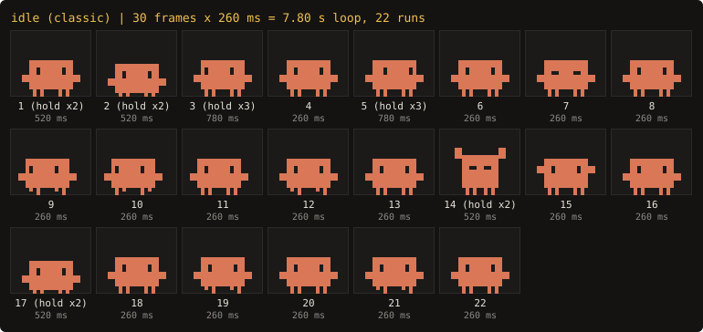

# Timing and spacing

> **Read when:** deciding how many frames, how long each stays, and how far things move. **Related:** [weight & impact](weight-and-impact.md) · [idles & aliveness](idles-loops-and-aliveness.md) · [studies/tempo-is-character](../studies/tempo-is-character.md)

*A lens, not a law: everything below is a default with a reason. Break it on purpose when you have a better idea, and say why.*

## The question

*When does it move, how far, and how long does it stay there?*

## Why it works

**At tiny scale, time is the free channel.** With 2-4 frames and 1 px changes, how long each frame stays and how far parts jump matter more than how many frames you draw. A held frame costs zero pixels and says weight, intent and mood. Several sprite-animation guides rank timing first and call equal frame durations "mechanical" (these guides are unsigned and repeat each other, but they agree with Slynyrd and the Disney principle of timing). The same drawings at different rates feel completely different: an 8-frame walk at 12 fps is a stride; at 24 fps it is a shuffle.

**Think in milliseconds, not fps.** 4 fps = 250 ms, 6 fps ≈ 167 ms, 8 fps = 125 ms, 12 fps ≈ 83 ms.

**Spacing is quantised, so shape speed with offsets and durations.** Spacing = distance between successive positions; timing = how long each stays. Equal gaps read as constant speed, widening gaps as acceleration, bunching as deceleration. In whole pixels that means steps like 1, 2, 3 px (or the reverse). A worked fall from SpritePilot moves the top edge 3, 5, then 9 px over successive frames before a squash on impact.

**Ease with holds, not in-betweens.** Classic slow-in/slow-out puts more drawings near extremes. With 2-4 frames you can't, so hold the extreme poses longer and play the middle fast. Duplicating a frame is a legitimate way to hold it. Sprite AI's four-frame attack sample (150 ms wind-up, 200 ms anticipation peak, 50 ms strike, 120 ms recovery) shows the shape: a long hold before a very fast strike is the contrast that makes the hit feel heavy.

**Cut frames by deleting the weakest drawing and lengthening the rest.** Slynyrd reduces an 8-frame run (80 ms/pose) to 6, then to 4, removing the recoil frame first (close to the contact pose) and the high point last, and doubling the surviving poses to 160 ms so the loop keeps its energy. "Trust your keyframes": more in-betweens can make motion sluggish, and Sakurai (Kirby) warned that too many frames feel sluggish.

**Typical values (rules of thumb, test by eye):**

| Loop | Frames | Per-frame time | Source |
|---|---|---|---|
| idle / breathing | 2-4 | 300-800 ms (400-500 typical) | Sprite AI, PiXiMelon |
| walk | 4-8 | 80-150 ms | Sprite AI, Postma |
| run | 4-8 | 50-100 ms | Sprite AI, Slynyrd |
| jump | 3-5 | launch 60-80, apex hold 120-180, land squash 80-120 ms | Sprite AI |
| pixel-art "twos" | | 8-12 fps; slow ambient ~6 fps | NeatForge, Pixel Overload |

**Reuse is how old hardware did it.** Link's Awakening walks in two frames where the second is the first mirrored; Pokémon Gold/Silver walk is four beats from two unique drawings, the idle frame appearing twice (Niko Uusitalo). Players didn't notice. Gen 5 Pokémon idles ran on 50 ms ticks with many frames held for two beats, played a common loop three times then a rare one, always starting and ending on the rest pose (Oripoke).

## Look at it: how our engine handles time

Each Clawd animation has **one fixed ms per frame** and expresses holds by **repeating a frame**. Examples from `crew-sprites.js` (computed for this KB):

| Animation | ms/frame | Frames | Loop | Distinct frames |
|---|---|---|---|---|
| sleeping | 500 | 20 | 10.0 s | 9 |
| idle | 260 | 30 | 7.8 s | 11 |
| thinking | 350 | 24 | 8.4 s | 20 |
| typing | 250 | 40 | 10.0 s | 9 |
| error | 140 | 32 | 4.5 s | 6 |
| done | 130 | 10 | 1.3 s | 7 |
| running | 110 | 8 | 0.9 s | 8 |

The slow-to-fast ordering is already **tempo as mood**: sleeping crawls (500), thinking ambles (350), typing is a steady 250, error twitches (140), done pops (130), running sprints (110). That is exactly the Pokémon party-icon principle (tempo and amplitude carry state) and Invaders' "tempo is character".

Look at the idle loop as a sequence of holds: the glances left and right are held three beats, the stretch two, and between them sit one-beat micro-changes (a breath, a blink, a step):

Takeaway: with a uniform ms quantum, **your timing resolution is the quantum**. 260 ms means holds come in multiples of 260 ms: great for relaxed idles, too coarse for a 100 ms blink (a one-frame blink at 260 ms is long; see [studies of our animations](../clawd/studies-of-our-animations.md)).

## In practice

1. **Decide the beat, then the pose.** Pick the ms per frame that sets the mood (500 drowsy, 250 steady, 110 frantic), then place holds as repeated frames.
2. **Hold what you want noticed; speed through what you don't.** The eye lingers on the pose you hold.
3. **Check spacing with an onion skin**: gaps between successive positions should be even for constant speed, growing for acceleration.
4. **Double the movement before you add frames.** If a change is invisible at 1x, make it 2 px, or hold it longer, not another in-between.
5. **Keep frame differences meaningful**: each frame should move at least 1 px, and key differences about 2 px on a 16-20 px sprite (Pixeli 14; Slynyrd).
6. **Loop duration is a tool.** Short loops (1-2 s) read as busy; long loops (8-10 s) with sparse events read as calm. Mixed periods avoid lock-step (see [idles](idles-loops-and-aliveness.md)).
7. **Test the real playback.** Seams, holds and rhythm only show in motion, not when scrubbing.

## Tensions

- **Latency vs anticipation.** Anticipation adds a delay. For reactive UI, use a one-frame (60-80 ms) cue or fold anticipation into the launch; reserve long wind-ups for non-urgent transitions (falling asleep, celebrating).
- **Uniform quantum vs expressive holds.** A fixed ms per animation is simple and cheap; per-frame durations would be more expressive. Neither is wrong; know which one you've chosen.
- **Smoothness vs energy.** More frames give smoothness, not energy. Frame count is also independent of screen refresh.

## Ask yourself

- If I tripled this hold, would it become funnier, heavier, or just slower?
- Is everything on the same clock? What happens if I offset one part?
- What does the tempo alone say, with the pixels covered?

## Sources

[Slynyrd Pixelblog 8: Intro to Animation](https://www.slynyrd.com/blog/2018/8/19/pixelblog-8-intro-to-animation) · [Sprite AI: animation principles](https://www.sprite-ai.art/guides/animation-principles) and [frame budgets](https://www.sprite-ai.art/blog/sprite-animation-frames) · [PiXiMelon: timing & loops](https://piximelon.com/guides/pixel-art-animation-basics/) · [SpritePilot: squash & stretch](https://spritepilot.com/blog/squash-and-stretch-sprites) · [Niko Uusitalo: Looking at Pixels](https://www.nikouusitalo.com/blog/looking-at-pixels-part-1-characters/) · [Oripoke: animated Pokémon sprites](https://oripoke.wordpress.com/2025/06/21/how-to-make-animated-pokemon-sprites/) · [Shmuplations: Kirby interview](https://shmuplations.com/kirbynightmare/) · [Postma: pixel art animation](https://spritesheetgenerator.online/guides/pixel-art-animation) · [Pixeli 40 Timing and spacing](https://pixeli.pebbly.space/knowledge/rules/40-timing-and-spacing). Engine numbers from `crew-sprites.js`. Millisecond figures from guide sites are starting points (see [references](../references.md)). Raw notes: [animation](../research/animation.md).
