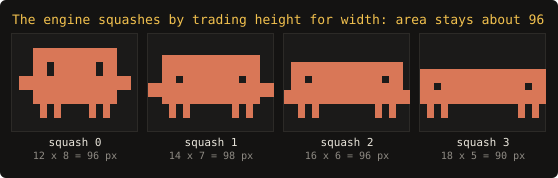
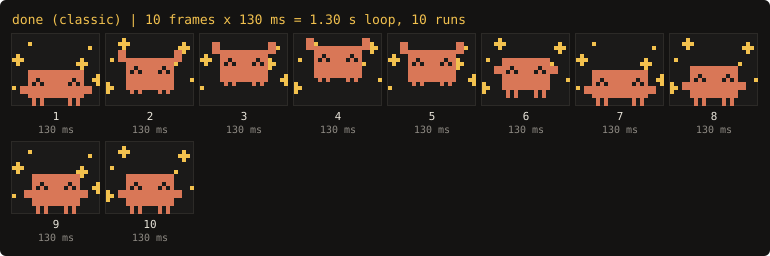

# Weight and impact

> **Read when:** something should feel heavy, springy, sudden or soft: a hop, a landing, a flinch, a snap. **Related:** [timing](timing-and-spacing.md) · [idles & aliveness](idles-loops-and-aliveness.md)

*A lens, not a law: everything below is a default with a reason. Break it on purpose when you have a better idea, and say why.*

## The question

*How do I make a few rectangles feel like they have mass and the world has gravity?*

Of the twelve classic Disney principles, one guide (Sprite AI) says three translate directly to small sprites: **squash and stretch, anticipation, follow-through**. Add **holds** and **smears** and you have most of what a 16 px character needs.

## Squash and stretch

**Why it works.** A deformation that lasts one or two frames lets the eye read energy without noticing the deformation. Remove it and a jump feels wrong though viewers can't say why.

**Keep the volume.** Width times height should stay roughly constant (within ~10%). SpritePilot's arithmetic: a 24x24 ball (576 px) squashed to 16 tall wants to be about 36 wide; squash without widening and it reads as *shrinking*. If a squash looks wrong, count pixels; it is usually too small or lost its width.

**Our engine already does this right.** Clawd's squash trades height for width exactly like that:

12x8 = 96, 14x7 = 98, 16x6 = 96, 18x5 = 90 pixels. That's a good conservation of volume, and it is why the squashed Clawd still reads as the same crab, only pressed. The engine also swaps the 1x2 eyes for a 1x1 dot when the body gets too flat for its usual eyes, which is the right call: features follow the budget.

**Pixel rules of thumb.** At 16 px a squash of 1 px is already about 6% of height, and visible. Squash on the **contact frame**, pivoting from the contact point, so feet stay on the same row. Stretch only on the fastest frames just before and after impact. One frame of squash suggests something stiff; two suggests soft and slow to recover. A bowling ball loses 1-2 px; a water balloon half its height. Exaggeration beats accuracy at this scale: subtle changes on a 32x32 sprite are nearly invisible. Blink = squash the eyes, don't redraw them (PiXiMelon).

## Anticipation

One frame of counter-movement before the main action: a crouch before a jump, a pull-back before a punch. It points attention where the action will go and makes the motion feel grounded; Richard Williams frames it as one end of a pendulum. Typical cost: 1 frame, 120-200 ms. It also telegraphs.

**The latency problem.** In a UI that reacts to events, anticipation is delay. Use a very short cue (60-80 ms), fold anticipation into the launch, or reserve it for non-urgent transitions. A trick attributed to Saint11 (UNVERIFIED: only a search snippet of a developer's post): draw the squash frame at the start of a jump but have the character already leave the ground on it; it reads as anticipation and stays snappy.

## Follow-through and overlap

Parts of a figure lag a few frames behind the body (drag), and secondary action should reinforce the main action, not compete. Scaling by size: at 32x32, 1-2 extra frames for hair, tail or ears; at 16x16, about 1 px of trailing; at 8x8, skip it (Sprite AI). A cheap, powerful version: a 1 px body bob plus a 1 px lag on one appendage separates "breathing" from "bobbing" (PiXiMelon).

For Clawd the candidates are claws (lag the body by one beat), a hat tip or pompom, a held prop. A trailing part also exposes bad volume: if a claw lags, check that it isn't also changing size.

## Smears and holds

- **Smear frames** (Williams' term): one frame that distorts or repeats the subject to fake motion blur, placed near top speed, with ease before and after. At 32x32 and below, a 2 px trail works. Use only on the fastest frame, don't resize (resizing blurs pixels; extend existing pixels with existing colours). For a claw snap: extend the claw 1-2 px along the motion on the one fast frame, leave the body alone. Overuse clutters (CGWire).
- **Holds** give weight and emphasis with no new art; hold the impact and the apex longer. Williams' caution: don't pause without a reason. A hold needs a story (thinking, waiting, listening).
- **Moving holds**: a pose that must stay still gets a tiny drift (a 1 px breath, a blink), rarely a frozen frame. Stillness reads as broken.

## Look at it

The "done" celebration is a 10-frame, 130 ms loop, and it is a textbook hop in miniature (read straight from the engine's frame list):

| Beat | Pose | Principle |
|---|---|---|
| 1 | body squashed one step (wider, shorter), happy eyes | **anticipation**: the crouch |
| 2-5 | rises 2, 4, 5 rows then comes back to 4 (gaps of 2, 2, 1 going up), legs tucked, claws up | **launch and spacing**: gaps shrink toward the apex, so it decelerates into the peak |
| 6 | back down to 2 rows up, claws mid | the descent |
| 7 | squashed again | **contact squash**: the landing |
| 8-10 | settles, the two sparkle positions alternate | a **moving hold**: the body is still but the sparkles keep it alive |

Nothing is held longer than one beat; the energy comes from **tempo (130 ms) and amplitude**, not frame count. Two observations: the apex isn't held, so there is no "hang"; an extra beat at frame 4 would add triumph at the cost of speed. And the squash conserves volume (see above), so the crouch and landing look like the same crab, not a different one.

## Tensions

- **Squash accuracy vs exaggeration.** Physics-correct volume reads right; over-exaggerated squash reads funny. Pick by tone: "done" can be funny, "error" shouldn't be.
- **Weight vs responsiveness.** Heavy feels good in a game but laggy in a band. Prefer snappy with a held pose after, not before.
- **Smear vs crisp.** Smears add speed but can read as dirt in a flat-colour sprite; use one frame, one direction, once.

## Ask yourself

- Did I count the pixels before and after the squash?
- Where is the longest hold, and what is it for?
- What lags? If nothing lags, why does it feel stiff?
- Would a one-frame flinch say this better than a three-frame wind-up?

## Sources

[Sprite AI: animation principles](https://www.sprite-ai.art/guides/animation-principles) · [SpritePilot: squash & stretch](https://spritepilot.com/blog/squash-and-stretch-sprites) · [PiXiMelon: animation basics](https://piximelon.com/guides/pixel-art-animation-basics/) · [Wikipedia: Twelve basic principles of animation](https://en.wikipedia.org/wiki/Twelve_basic_principles_of_animation) · [Wikipedia: Smear frame](https://en.wikipedia.org/wiki/Smear_frame) · [CGWire: smear frames](https://blog.cg-wire.com/smear-frames/) · Williams via [book summary](https://sobrief.com/books/the-animators-survival-kit) (summary, not the book) · [Pixeli 44, 45](https://pixeli.pebbly.space/knowledge/rules/44-attacks-and-impacts). Engine figures from `crew-sprites.js`. [references](../references.md) · [raw notes](../research/animation.md).
